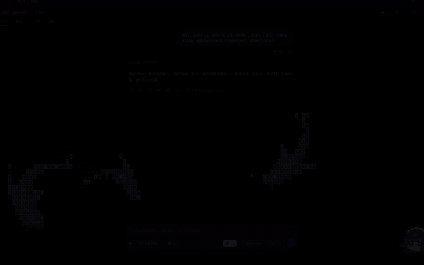

# dsh-constellation-picker

一个为 **DeepSeek Harness (DSH)** 打造的实验性模型选择器，把单调的模型下拉框换成「多厂商 × 能力梯度」的矩阵面板：厂商成列、能力分三层（旗舰推理 / 全能主力 / 轻量极速），推理深度用 Low / Medium / High / Extra 的气泡完成。

<p align="center">
  
</p>

<p align="center">
  <sub>10fps 精简预览（GIF 10.2 MB）· 想看 60fps 原始画质，<a href="./assets/demo.mp4">下载 demo.mp4（5.4 MB）</a></sub>
</p>

> **这不是成品，是一个起点。** 下面这段是写给接手的人看的，不是免责声明。

## Project Status & Design Philosophy

This project is an experimental foundation, not a finished product.

The current implementation is only **one possible interpretation** of a better model-selection experience. You are encouraged to refactor it, redesign it, replace individual components, or build an entirely new interface on top of the existing model-selection logic — a VS Code style command palette, a capability quadrant chart, a restrained list, whatever you think is better.

**We value maintainability, extensibility, and creative freedom over preserving the original implementation.**

中文：当前实现只是“更好的模型选择体验”的一种解法。你可以重构、重设计、替换任意组件，甚至只复用它的模型目录与切换逻辑、完全不用这套 UI——这些都算项目成功，不算跑偏。

唯一希望后来者遵守的一条：**不要让接手的人必须先理解作者的审美，才能理解这份代码。**

## 30 秒上手

| 我想… | 去哪 |
| --- | --- |
| 先看看长什么样 | 本地起个静态服务器，打开 `demo.html`（自带 mock 模型目录，不需要 DSH） |
| 理解代码结构 | [`ARCHITECTURE.md`](./ARCHITECTURE.md) —— 分层图、数据流、props 契约、哪些地方改了会炸 |
| 动手改 | [`CONTRIBUTING.md`](./CONTRIBUTING.md) —— 环境、本地调试、三类改动的风险边界、提交规范 |
| 装进自己的 DSH | 见 CONTRIBUTING 的「装进 DSH」一节（复制到 profile + 登记 `bundles`） |
| 知道现在有哪些坑 | 下面的 Known Issues & Roadmap |

## 三层自由度

| 层 | 内容 | 自由度 |
| --- | --- | --- |
| **Core** | 槽位注册、原生按钮定位、`directory.select()` 切换 | 谨慎：改错表现为“插件消失” |
| **Config** | `src/core/vendor.js`（厂商品牌、未接入占位）、`src/core/classifier.js`（三档分类规则） | 自由扩展：加厂商、调分类不用碰 UI |
| **UI** | 面板布局、矩阵、卡片、动画、配色 | 鼓励推翻：只要满足 `PeriodicPicker` 的 props 契约 |

UI 层的数据契约（实现一个新 UI 只需要这个）：

```ts
interface PickerProps {
  available: boolean;
  directory: { subscribe(fn): () => void; getSnapshot(): State };
  load(): void;
  select(sel: { provider: string; model: string; reasoningEffort?: string }): Promise<{ ok: boolean; error?: any }>;
  locked?: boolean;
}
```

## ✨ 现有特性

* **多厂商能力矩阵**：按厂商分列，按能力梯度分层，未接入厂商暗态占位；悬停任意卡片实时刷新顶部预览。
* **推理深度气泡**：`Low` / `Medium` / `High` / `Extra` 四档（带 1~4 格信号柱），边缘自动避让；不区分深度的模型点击即选中。
* **同频展开动效**：新对话居中态触发「欢迎语淡出 + 输入框下移 + 面板自胶囊锚点放大」。
* **键盘与搜索**：实时过滤，`↑` `↓` 移动、`Enter` 确认、`Esc` 逐层退出。
* **崩溃隔离**：整棵子树包在 ErrorBoundary 内，异常时还原原生按钮，不拖垮输入框。
* **深浅主题**：胶囊按输入框背景亮度自动配色。

## 📦 安装与使用（Installation）

### 方式一：装进 DeepSeek Harness 客户端

**1. 克隆仓库**

```bash
git clone https://github.com/yloong0116-png/dsh-constellation-picker.git
cd dsh-constellation-picker
```

仓库里已提交构建产物 `lib/client.js`，**不需要 npm install 或构建**就能直接用（改源码才需要 `npm run build`）。

**2. 复制到 profile 的 node_modules**

```bash
# Windows（默认 profile 名为 desktop）
cp -r . "%USERPROFILE%\.dsh\profiles\desktop\node_modules\dsh-constellation-picker"

# macOS / Linux
cp -r . ~/.dsh/profiles/<profile>/node_modules/dsh-constellation-picker
```

**3. 在 profile 的 package.json 里登记两处**

```jsonc
{
  "dependencies": {
    "dsh-constellation-picker": "file:<仓库绝对路径>"
  },
  "dsh": {
    "profile": {
      "bundles": ["...", "dsh-constellation-picker"]
    }
  }
}
```

两者缺一不可：`dependencies` 让 Node 能解析到包，`dsh.profile.bundles` 让 host 在启动时加载它的 patch。

**4. 重启 DeepSeek Harness**

输入框右下角的原生模型按钮会被替换成胶囊。只想让它热更新而不重启整个客户端时，用插件管理器把 `constellation-picker` 停用再启用一次。

> **关于 ID**：cordis 条目 id 是 `constellation-picker`，包名是 `dsh-constellation-picker`（早期版本叫 `dsh-periodic-model-picker`，已改名）。换 ID 的地方只有 profile 的包名。

> **为什么不用 `dsh plugin install`**：`dsh plugin --profile <name>` 会把参数转发给 pnpm，但 desktop profile 由 Electron 独占管理，CLI 会直接报 `profile "desktop" is managed exclusively by the Electron application`。桌面版只能按上面的方式手动登记然后重启。

### 方式二：只预览交互动画（不装客户端）

`demo.html` 用 `fetch` 读取模拟目录，`file://` 下会被浏览器的跨域策略拦掉，**必须跑一个静态服务器**：

```bash
npx serve .            # 或 python -m http.server 3000
# 打开 http://localhost:3000/demo.html
# 换任意模拟目录：http://localhost:3000/demo.html?catalog=./demo/mock-catalog.json
```

内置 mock 数据覆盖 DeepSeek / OpenAI / Gemini / Kimi 四列，可以直接试展开动画、悬停预览、Low/Medium/High/Extra 档位气泡、搜索与 `↑``↓``Enter` 键盘导航。

### ⚠️ 更新、重装或移除之后：必须完整重启

插件被移除、重新安装或更新后，请**完全退出 DeepSeek Harness 再启动**（`F5` 不够）。

`F5` 只重载渲染进程，host 端的 client bundle 注册表不会重建；此时前端会去请求一个旧 `rev` 的 bundle，得到
`GET dsh-app://app/plugins/??<pkg>/client.js&rev=… 404`，随后 `web boot: 1 entry did not activate`，表现为启动失败。

已用官方 `@deepseek-ai/dsh-api-gateway` 对照验证：正确 `rev` → 200，错误 `rev` 或不带 `rev` → 404 —— 404 表示「这条 rev 的条目不在 host 的表里」，不是文件缺失。


### 卸载与恢复原版

任选其一：

1. 用插件管理器停用 `constellation-picker`（不改文件，随时可再启用）；
2. 从 profile 的 `package.json` 删掉 `dependencies` 与 `dsh.profile.bundles` 里的对应项，并删除 `node_modules/dsh-constellation-picker` 目录。

刷新或重启后即恢复原生模型选择器，历史对话与会话数据不受影响。

---

## 🧭 Known Issues & Roadmap

15 条技术债，按「会坏的 → 用起来硌手的 → 工程债」排序，欢迎认领任意一条。

### A. 结构性脆弱点

1. ~~**定位原生按钮依赖文本匹配**~~ → 已改为结构特征优先（`aria-haspopup` + composer 容器内的兄弟关系）、缓存节点 + MutationObserver 兜底，文本匹配降为最后兜底。
2. **`priority: -100` 抢 single slot**：依赖 DSH 内部“同名低优先级覆盖”规则，升级若改规则会失效；失败时静默退化到 `conversation.input.dock`。
3. ~~**rAF 循环常驻**~~ → 已改为仅在面板打开时逐帧同步；关闭态由 resize / scroll / ResizeObserver 事件驱动，`visibilitychange` 自动暂停。
4. ~~**缺少错误边界**~~ → 已包裹 `PickerBoundary`，崩溃时恢复原生按钮并降级为不渲染。

### B. 体验缺口

5. ~~**没有键盘导航与搜索**~~ → 已加搜索框 + `↑`/`↓`/`Enter`，但尚未支持 Tab 焦点环与屏幕阅读器播报。
6. **三档归类靠模型名正则**（`reason|pro|flash|mini`）：厂商命名一变就归错档，应改为读取目录元数据或配置覆盖。（档位气泡已不再假设数组下标 = Low/Extra）
7. **配置未真正解耦**（部分完成）：已从 UI 中剥离到 `src/core/vendor.js` / `classifier.js` 纯函数模块，但仍是 JS 常量，没有独立 JSON 与 host 端配置路由。
8. **面板固定白卡**：暗色主题下胶囊已适配，面板仍是白色，视觉割裂。
9. **收起动画与展开不同频**：展开 320ms 弹性曲线，收起仍是 175ms 后卸载（定时器已可取消）；两端曲线尚未统一。
10. **没有“最近使用 / 收藏”**：跨厂商切换每次都要重新找位置。

### C. 工程与发布

11. ~~**单文件、无类型、无测试**~~ → 已拆为 `src/core`（纯函数）、`src/adapter`（框架无关 controller）、`src/index.js`（UI + 注册）；`build.mjs` 零依赖拼成 `lib/client.js`；补了 `types/index.d.ts` 与 10 条单测。UI 组件仍未按组件粒度拆分。
12. **缺视觉证明**：没有 GIF / 截图（欢迎贡献录制）。
13. **`demo.html` 依赖 esm.sh CDN**（部分完成）：已支持 `?catalog=<url>` 加载任意模拟目录，`demo/mock-catalog.json` 是默认数据；离线仍打不开，需要 vendored React。
14. **无 lint / format / CI**（部分完成）：已有 `npm run build` / `test` / `check` 与 CHANGELOG；CI 与格式化尚未接入。
15. **硬编码中文**：未接 DSH 的 locale 服务。

## 🙌 贡献者

| 贡献者 | 角色 |
| --- | --- |
| **DeepSeek Harness (DSH)** | 宿主平台与接口提供方。本项目的槽位注册（`slots`）、模型目录（`modelDirectories`）、切换链路（`directory.select`）与 React 运行时全部由 DSH 提供；没有它，这份代码无从存在。 |
| **YG** | 作者。交互设计、实现与文档。 |
| **Codex** | 协作评审：代码审查、架构与重构建议（core/adapter 分层、测试与类型契约的落地讨论）。 |
| **Gemini** | 协作评审：交互与视觉方案的设计反馈、接手性（contributor experience）评估。 |

欢迎把你的名字加进这张表——提交一个有实质改动的 PR 即可。

## 📄 License

MIT License
